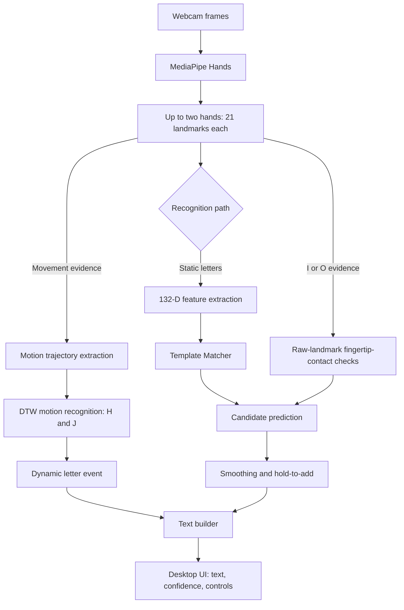

# BSL Two-Handed Fingerspelling Recognition System
## Technical Project Documentation

**Repository:** https://github.com/Pirushalini/sign-language-detector
**Documented branch:** `fix-letter-recognition-accuracy`
**Working snapshot:** `257d844` (November 2026)
**Document status:** Technical draft, based on repository implementation and the project's reported tests. Formal independent accuracy evaluation is pending.

---

## 1. Executive Summary

This project is a desktop application for recognizing letters of the British Sign Language (BSL) two-handed fingerspelling alphabet through a webcam and converting recognized gestures into text. It uses MediaPipe hand landmarks, a feature-based template matcher for static signs, a dynamic-time-warping (DTW) approach for movement-based H and J, and a targeted fingertip-contact detector for I and O. A graphical interface provides live camera feedback, predicted letters, confidence scores, text-building controls, a reference alphabet chart and a practice mode.

The project has demonstrated an A–Z output sequence on the developer's laptop. This is evidence that the end-to-end workflow can function, but it is **not** an independently measured 100% recognition accuracy. Performance across other signers, cameras, lighting conditions and repeated attempts requires further validation.

## 2. Problem Statement and Objectives

### Problem
Many fingerspelled letters are distinguished by small changes in the relative configuration and contact points of two hands. A real-time recognizer must distinguish visually similar signs, tolerate limited variation in camera views and hand positions, and handle moving letters without unintentionally classifying transient motion as a static letter.

### Objectives
1. Recognize the 26 letters of the project-specific BSL fingerspelling chart using a standard webcam.
2. Convert detected signs into text through a desktop interface.
3. Support both static and dynamic recognition, particularly H and J movements.
4. Allow personalization using locally recorded hand-landmark templates.
5. Reduce flickering predictions and unintended repeated characters.
6. Evaluate reliability by letter, user, and recording condition.

### Scope
The implementation targets **fingerspelling letters**, not full sign-language words, sentences, facial grammar or translation. The reference chart included in the repository defines the supported gestures.

## 3. Technology Stack

| Technology | Role |
|---|---|
| Python 3.11 (recommended) | Application language; repository supports Python 3.9–3.12 |
| MediaPipe Hands 0.10.14 | Detection/tracking of 21 landmarks per hand |
| OpenCV | Webcam acquisition and image processing |
| NumPy 1.26.4 | Numerical arrays and distances |
| CustomTkinter | Desktop graphical user interface |
| Pillow | Image handling in the interface |
| scikit-learn | Optional experimental ML backends and evaluation |
| pytest | Automated checks |

The exact supported package list is maintained in [`requirements.txt`](https://github.com/Pirushalini/sign-language-detector/blob/fix-letter-recognition-accuracy/requirements.txt).

## 4. System Architecture



**Runtime priority:** The motion recognizer inspects incoming frames. During active motion tracking the static path is suppressed. Otherwise, static template prediction is calculated. If the specialized I/O contact detector reports a sufficiently clear contact pattern, it may override the static prediction. Static letter acceptance is then controlled by smoothing and hold logic; dynamic letter events have their own recognition flow.

The arrow for fingertip contact denotes an **experimental heuristic**: its thresholds and reported score are not a statistically calibrated probability.

## 5. Landmark Extraction and Static Features

MediaPipe identifies up to two hands with 21 hand landmarks each. The `utils.py` implementation converts them into a **132-dimensional vector**:

- **63 features per hand:** 21 landmarks × x, y and z coordinates × 2 hands = 126.
- **4 inter-hand features:** information on relative wrist positions and separation.
- **2 presence flags:** whether each hand is detected.

Hand landmarks are translated relative to their respective wrist and normalized by a hand-scale reference. This reduces translation and scale sensitivity, but separately normalized hands make exact physical inter-hand contact distances difficult to reconstruct from saved 132-D vectors. Direct raw-landmark contact checks are therefore important for the I/O rules.

The project supports one-handed and two-handed signs according to its chart; the normal static recognition path uses the presence flags and additional hand-count checks.

## 6. Static Letter Recognition

**Primary backend:** `TemplateMatcher` in `matcher.py`.

1. Read external and locally recorded landmark templates.
2. Compare the live feature vector with stored reference vectors.
3. Evaluate both hand orders where appropriate to reduce errors caused by inconsistent hand ordering.
4. Compute a per-letter score using the average of the nearest `k=3` examples for that letter.
5. Convert relative scores into confidence-like values using a temperature-based transformation.
6. Reject matches exceeding the configured maximum distance.
7. Pass the candidate to smoothing and hold-to-add logic.

Default matcher settings include `inter_weight=2.0` and `rel_weight=0.0` in the application's template backend. The application also includes a conservative E/D and O/U contact-related reranking experiment in its matcher implementation. These heuristics should be evaluated against both the intended target letter and the previously working confusable letter.

**Interpretation caution:** The displayed score is derived from template distances; it should not be described as a calibrated probability of correctness.

### Alternate/experimental ML systems
The repository also includes experimental machine-learning work and a selectable ML backend. These are separate from the current user's confirmed **template** setting. Unless a specific trained model is selected and loaded, do not describe the live application as using the 157-dimensional SVM experiment.

## 7. Specialized I and O Contact Detection

Some BSL vowels rely on the pointing-hand index fingertip touching or approaching a particular fingertip on the supporting hand. `detect_io_contact()` in `app.py` uses **raw MediaPipe 2D landmark coordinates** rather than reconstructed 132-D contacts.

- **I:** pointing index fingertip near the supporting **middle** fingertip (MediaPipe landmark 12).
- **O:** pointing index fingertip near the supporting **ring** fingertip (landmark 16).

The detector checks both possible assignments of pointing and supporting hands. It uses finger-straightness heuristics, the distance to all five supporting fingertips and a minimum separation between the nearest and second-nearest candidates. It returns no special classification if the contact evidence is inconclusive.

The current special-case prediction uses an **assigned score of 0.86** to pass downstream acceptance logic. This is a fixed heuristic value and **must not** be reported as 86% model accuracy or validated confidence. Incorrect hand tracking, perspective and occlusion may still cause false decisions.

## 8. Dynamic H and J Recognition

`motion.py` implements a streaming motion-recognition pipeline for H and J rather than relying only on a single static hand shape. The method uses a palm-relative motion representation, collected trajectories, normalization/resampling and **dynamic time warping (DTW)** to compare live movements with recorded references. The recognizer also models a `NONE` (negative) movement class to reduce accidental activation.

The streaming recognizer has states such as **IDLE**, **TRACKING** and **COOLDOWN**, with thresholds for motion speed, path length and match rejection. Motion detection is integrated into `app.py`, and static recognition can be suppressed while a movement is being tracked.

**Current limitation identified from the developer's local data check:** `data/motion_templates.npz` contained **68** trajectories at the time of inspection: H = **1**, J = **27**, NONE = **40**. The single H example is a serious generalization limitation; successful demonstration does not establish robust H recognition across new users.

## 9. Datasets and Calibration

| Local dataset | Observed content | Repository distribution |
|---|---|---|
| `data/templates_external.npz` | 9,200 rows × 132 features; 23 static-letter classes; 400 examples per class | **Not tracked** in Git; obtain original source under appropriate permissions and regenerate locally |
| `data/templates_user.npz` | 1,143 rows × 132 features in the verified working snapshot | Tracked and pushed with the working snapshot |
| `data/motion_templates.npz` | 68 trajectories × 30 time steps × 7 motion features | Tracked and pushed with the working snapshot |

The external data lacks H, J and Y. The developer's current personal static dataset included one stored personal example each for E, I and O, with other letters represented by varying counts. The app can still compare against the external templates and use special-case geometry; nevertheless, the low per-letter personal counts need to be stated as a limitation.

### Licensing and reproducibility

The repository's [`NOTICE.md`](https://github.com/Pirushalini/sign-language-detector/blob/fix-letter-recognition-accuracy/NOTICE.md) identifies the third-party Kaggle dataset and notes that its redistribution terms are unclear. Do **not** force-commit or republish `templates_external.npz` or the original CSVs without appropriate permission. Users can obtain the authorized original source and generate `templates_external.npz` locally with `import_dataset.py`.

The source CSV files are expected at:

```text
data/external/two_hand_dataset.csv
data/external/one_hand_dataset.csv
```

The source templates file is not generated unless these files are present. In an existing local installation that already has `data/templates_external.npz`, running the importer again is unnecessary.

**Reproducibility note:** `settings.json` is local. Other teammates should check backend = `template`, threshold = `0.80`, smoothing = `7`, maximum distance = `1.5` and the relevant camera configuration to reproduce the developer's chosen runtime setup. Different camera hardware and signer appearance can still change recognition results.

## 10. Application Modules

| Path | Responsibility |
|---|---|
| `app.py` | Desktop UI, camera thread, prediction integration, I/O contact override, movement events |
| `utils.py` | Hand tracking and 132-D feature construction |
| `matcher.py` | Template file operations, static similarity scores and targeted reranking |
| `logic.py` | Settings, smoothing, hold-to-add and practice logic |
| `motion.py` | DTW-based H/J motion tracking and classification |
| `calibrate.py` | Guided personal static-template collection |
| `record_motion.py` | Motion template collection |
| `import_dataset.py` | Convert authorized external CSV landmark dataset into templates |
| `evaluate.py` | Evaluation utilities and reports |
| `geometric_features.py` | Experimental 152-D/157-D feature functions, not imported by the live app |
| `experiments/compare_152_vs_157.py` | Exploratory comparison of feature representations |
| `requirements.txt` | Python environment dependencies |
| `tests/` | Automated tests |

## 11. Installation and Running

### 11.1 Obtain the code

```bash
git clone -b fix-letter-recognition-accuracy https://github.com/Pirushalini/sign-language-detector.git
cd sign-language-detector
```

Teammates with an existing clone can `git fetch origin`, switch to this branch (after preserving any local edits) and `git pull --ff-only`.

### 11.2 Prepare Python environment

macOS/Linux, with Python 3.11 installed:

```bash
python3.11 -m venv .venv
source .venv/bin/activate
python -m pip install -r requirements.txt
```

Windows PowerShell, with Python 3.11 installed:

```powershell
py -3.11 -m venv .venv
.venv\Scripts\Activate.ps1
python -m pip install -r requirements.txt
```

### 11.3 Verify datasets

The Git branch includes the personal and motion templates, but **does not include** `data/templates_external.npz`. To reproduce the full external-plus-personal template setup, download the source dataset only through an authorized channel, place the original CSVs under `data/external/`, then run:

```bash
python import_dataset.py
```

A successful equivalent import should produce 9,200 rows, 132 features, 23 classes with 400 samples per class. Exact output may depend on importing the same source and preprocessing settings.

### 11.4 Run and check

```bash
python app.py
```

Choose a working camera, keep both hands visible, and check the reference chart. Avoid editing the templates while testing. For automated tests:

```bash
python -m pytest tests -q
```

The program can launch without the external dataset if personal templates are available, but recognition results will not necessarily reproduce the developer's full setup.

## 12. User Guide

1. Open the application and start the camera.
2. Perform a gesture matching the application's reference chart.
3. Observe the predicted letter, Top 3 and the current hold progress.
4. Hold a stable static sign until accepted; for H/J make the required movement.
5. Build the desired text using letter recognition and the Erase, Space, Reset and Copy controls.
6. When repeating the same letter, briefly relax or lower the hands before signing it again to let the hold mechanism reset.
7. Use the Settings panel to choose camera and recognition thresholds; keep experimental comparisons consistent by recording those settings.

## 13. Testing and Evaluation Plan

### 13.1 Functional testing

| Test ID | Scenario | Expected outcome |
|---|---|---|
| FT-01 | Start the webcam | Live video and landmarks available |
| FT-02 | Hold a valid static letter | Correct letter eventually added to the text |
| FT-03 | Make H/J movement | Correct dynamic letter, no unintentional static output |
| FT-04 | Make I and O contact signs | Correct fingertip-specific classification |
| FT-05 | Remove one hand during a two-handed sign | No unsupported two-hand acceptance |
| FT-06 | Repeat the same letter deliberately | Exactly two intended characters, no uncontrolled repeats |
| FT-07 | Use Erase / Space / Reset / Copy | Text editing actions behave as expected |
| FT-08 | Test camera selection and restart | Application recovers and resumes tracking |

### 13.2 Recognition evaluation protocol

- Use **26 letters × 10 fresh attempts = 260 trials per signer** as an initial structured test. This is an evaluation plan, not a completed result.
- For each trial record intended letter, produced letter (or no output), recognition time, camera/lighting condition and whether an extra unintended character was added.
- Test the previously confusable pairs **E/D, I/E, O/U, R/L** particularly carefully.
- Test H/J separately for missed movements and false activations during ordinary hand motion.
- Include at least one **unseen signer**; ideally use several signers and sessions. Do not include test-session examples in the calibration/training set.
- Report *per-letter recall*, confusion matrix, macro precision, macro recall, macro F1 and overall trial success. Also report no-output/rejection rates and unintended output separately.

**Suggested test log**

| Trial | True letter | Output letter / none | Correct? | Rejected? | Extra output? | Notes |
|---:|---|---|---|---|---|---|
| 1 | A | _to fill_ | _ | _ | _ | _ |
| 2 | A | _to fill_ | _ | _ | _ | _ |
| ... | ... | ... | ... | ... | ... | ... |

### 13.3 Status of current results

An A–Z text sequence was demonstrated on the developer laptop. Previous experiments with 132-D, 152-D and 157-D representations were **exploratory**, using a previously inspected E/I/O test session. They must not be presented as final independent evaluation. No completed 260-trial confusion matrix or independent multi-person test was supplied at the time of this draft.

## 14. Known Limitations and Risks

- Performance may vary between users, camera devices, hand sizes, lighting and image framing.
- MediaPipe may lose a hand when hands overlap or occlude one another.
- Similar letters may be confused, especially around contact-dependent poses.
- Exact inter-hand contact is not preserved by the 132-D normalized representation; the I/O raw-landmark rule partly addresses this but is heuristic.
- The I/O special-case output score is fixed at 0.86, not statistically calibrated.
- The H motion dataset currently has very limited template diversity.
- The non-redistributable external dataset complicates a clean clone-and-run experience for teammates.
- The README in the documented branch has older wording that should be updated: it describes the project as if it only performs static matching, states that a ZIP includes external templates, and does not fully cover H/J motion recognition or I/O contact logic.

## 15. Recommended Future Work

1. Conduct signer-independent and session-independent evaluation and publish measured results.
2. Collect diverse, correctly labeled H/J motion recordings and negative motion examples, with consent.
3. Replace fixed heuristic confidence scores with validated, calibrated decisions if a supervised evaluation dataset becomes available.
4. Study contact features derived from raw landmarks with consistent hand-scale handling.
5. Add regression tests for E/D, I/E, O/U and R/L so targeted changes do not degrade working classes.
6. Improve setup documentation and independently verify installation on Windows and other Macs.
7. Resolve third-party dataset redistribution and alphabet chart licensing before wider publication.

## 16. Repository References

- [Project repository](https://github.com/Pirushalini/sign-language-detector)
- [Documented branch](https://github.com/Pirushalini/sign-language-detector/tree/fix-letter-recognition-accuracy)
- [README](https://github.com/Pirushalini/sign-language-detector/blob/fix-letter-recognition-accuracy/README.md)
- [Application](https://github.com/Pirushalini/sign-language-detector/blob/fix-letter-recognition-accuracy/app.py)
- [Template matcher](https://github.com/Pirushalini/sign-language-detector/blob/fix-letter-recognition-accuracy/matcher.py)
- [Movement recognizer](https://github.com/Pirushalini/sign-language-detector/blob/fix-letter-recognition-accuracy/motion.py)
- [Data licensing notice](https://github.com/Pirushalini/sign-language-detector/blob/fix-letter-recognition-accuracy/NOTICE.md)
- [Requirements](https://github.com/Pirushalini/sign-language-detector/blob/fix-letter-recognition-accuracy/requirements.txt)

---

**Documentation review checklist before submission:** Fill in team member roles, institutional details, software requirements, captured screenshots, experiment conditions, independently measured metrics and citations/permissions for third-party datasets and chart artwork. Verify the branch's code and README remain aligned with these statements after further merges.
