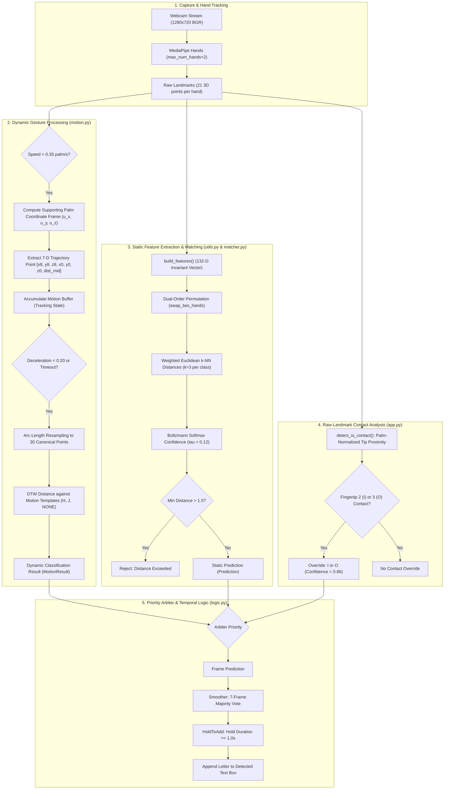

# Sign Language Detector (BSL Two-Handed Fingerspelling, A–Z)

[](https://www.python.org/)
[](https://developers.google.com/mediapipe)
[](https://github.com/TomSchimansky/CustomTkinter)
[](NOTICE.md)

A desktop-based British Sign Language (BSL) fingerspelling recognition system that translates the two-handed manual alphabet (A through Z) from a webcam feed into an editable text box.

The system runs locally on CPU hardware without sending video frames or landmark data over the network. The core recognition pipeline uses an **instance-based template matcher** operating over normalized, scale- and position-invariant hand landmarks without neural network training. To handle the visual and physical nuances of fingerspelling, static template matching is paired with **Dynamic Time Warping (DTW)** for movement-based letters (**H** and **J**) and **raw-landmark contact geometry** for vowel disambiguation (**I** and **O**).

## Technical Documentation

For detailed system architecture, algorithms, and implementation, see [Project Documentation](PROJECT_DOCUMENTATION.md).
---

## Table of Contents

- [Project Overview](#project-overview)
- [Key Features](#key-features)
- [Technologies Used](#technologies-used)
- [System Architecture](#system-architecture)
- [How the Recognition System Works](#how-the-recognition-system-works)
- [Static Letter Recognition (Template Matching)](#static-letter-recognition-template-matching)
- [Dynamic Letter Recognition (H and J)](#dynamic-letter-recognition-h-and-j)
- [I/O Fingertip Contact Recognition](#io-fingertip-contact-recognition)
- [Feature Extraction and Hand Landmarks](#feature-extraction-and-hand-landmarks)
- [Datasets and Personal Calibration](#datasets-and-personal-calibration)
- [Installation and Setup](#installation-and-setup)
- [Running the Application](#running-the-application)
- [GUI Features and Usage](#gui-features-and-usage)
- [Project File Structure](#project-file-structure)
- [Testing and Evaluation](#testing-and-evaluation)
- [Known Limitations](#known-limitations)
- [Future Improvements](#future-improvements)
- [Dataset Attribution and License Information](#dataset-attribution-and-license-information)
- [Troubleshooting](#troubleshooting)

---

## Project Overview

British Sign Language (BSL) fingerspelling uses a two-handed manual alphabet where the non-dominant hand typically serves as a reference palm while the dominant hand performs pointing, contact, or sweeping motions (with the exception of letter **C**, which is signed with a single hand).

### Design Principles

1. **Instance-Based Classification:**
   The primary static classifier uses non-parametric $k$-nearest template matching over stored landmark examples. New calibration samples take effect immediately without model retraining.
2. **Local and Privacy-Preserving:**
   Hand tracking and classification run synchronously on the local CPU; video frames and biometric landmarks are processed entirely on-device.
3. **Full Alphabet Architecture (A–Z):**
   Static letters are evaluated through the 132-D template matcher, movement letters (**H** and **J**) are handled by a streaming trajectory recognizer, and ambiguous vowel contacts (**I** and **O**) are evaluated with direct contact geometry.
4. **Decoupled Processing:**
   Camera acquisition and landmark inference execute in a background worker thread (`DetectorWorker`), keeping the CustomTkinter GUI responsive.

---

## Key Features

- **Full A–Z Alphabet Support:** Covers all 26 letters of the BSL manual alphabet chart.
- **132-Dimensional Invariant Features:** Normalizes translation, radial scale, camera distance, and aspect ratio for one- and two-handed poses.
- **Hand-Order Invariance:** Dual-order permutation matching evaluates both hand assignments ($\min(D, D_{\text{swap}})$) to handle MediaPipe hand label swaps and varying hand placement.
- **Dynamic Movement Recognition (H & J):** Trajectory extraction relative to the supporting palm, moving-average smoothing, 30-point arc-length resampling, and Dynamic Time Warping (DTW) matching.
- **Raw-Landmark I/O Contact Detection:** Direct geometric analysis of supporting-palm finger straightness and tip proximity to distinguish middle-finger (**I**) and ring-finger (**O**) contact.
- **Temporal Smoothing and Hold-to-Add:** A 7-frame majority voting buffer reduces transient noise, and a configurable `HoldToAdd` timer (default 1.0 s) prevents repeated-character stutter while a sign is held.
- **Desktop GUI:** Built with CustomTkinter, providing live camera display, optional skeleton overlay, relative confidence gauges, hold progress bars, top-3 candidates, accumulated text editing, and a settings modal.
- **Built-in Recording Tools:** Guided interactive scripts for static templates (`calibrate.py`) and dynamic motion takes (`record_motion.py`).
- **Optional Machine Learning Backend:** Duck-type compatible `MLBackend` architecture supporting scikit-learn models (SVM, KNN, Random Forest, MLP) via the Settings interface.

---

## Technologies Used

| Category | Technology / Library | Version / Requirement | Purpose |
| :--- | :--- | :--- | :--- |
| **Language** | Python | 3.9 – 3.12 (CPython) | Application runtime (MediaPipe 0.10.14 requires Python $\le$ 3.12) |
| **Vision & Pose** | Google MediaPipe | `mediapipe==0.10.14` | 21-point 3D hand landmark tracking |
| **Video & Imaging** | OpenCV | `opencv-python` (via MediaPipe) | Camera capture, frame transformations, DirectShow support |
| **Numerical Computing** | NumPy | `numpy==1.26.4` | Vectorized distance metrics, DTW, linear algebra |
| **Machine Learning** | scikit-learn | `scikit-learn>=1.3` | Offline benchmarking, classification metrics, optional ML backend |
| **Visualization** | Matplotlib | `matplotlib>=3.7` | Confusion matrix generation, template analysis plots |
| **Desktop GUI** | CustomTkinter & Pillow | `customtkinter>=5.2`, `pillow>=10.0` | Light-theme desktop interface and image rendering |
| **Testing** | pytest | `pytest>=7.0` | Automated test suite execution |

---

## System Architecture

The following diagram illustrates the data flow from camera capture to text display:



---

## How the Recognition System Works

Inference runs in a dedicated `DetectorWorker` background thread:

1. **Frame Capture and Pose Tracking:**
   Webcam frames are acquired at $1280 \times 720$ and processed via MediaPipe Hands (`static_image_mode=False`, `max_num_hands=2`). MediaPipe outputs up to two hand skeletons with 21 normalized 3D landmarks each.
2. **Dynamic Motion Evaluation:**
   `MotionRecognizer.process_frame()` computes dominant fingertip velocity relative to the supporting palm. If velocity exceeds $0.35\text{ palm-lengths/s}$, it enters `TRACKING` mode.
3. **Static Prediction Suppression:**
   While `MotionRecognizer.is_tracking` is true, static template evaluation is bypassed to prevent intermediate motion frames from triggering spurious static predictions.
4. **Static Matching & Contact Detection:**
   When dynamic tracking is inactive, landmarks are transformed into the 132-D representation via `build_features()`. Concurrently, `detect_io_contact()` evaluates raw landmark geometry for tight vowel contacts.
5. **Arbitration and Single-Hand Enforcement:**
   - If `detect_io_contact()` identifies an unambiguous middle- or ring-finger contact, it overrides the template prediction with **I** or **O**.
   - If only one hand is visible, the prediction is checked against `ONE_HAND_LETTERS` (`{"C"}`). Two-handed letters presented with a single hand are rejected immediately.
6. **Temporal Filtering and Hold-to-Add:**
   - `Smoother` accumulates frame predictions in a 7-frame sliding window. A letter is accepted only if it holds a strict majority ($> 50\%$).
   - `HoldToAdd` monitors candidate stability. If the candidate remains above the confidence threshold (default 80%) for the configured duration (default 1.0 s), the letter is appended to the text buffer, and a release lock prevents duplicate typing.

---

## Static Letter Recognition (Template Matching)

Static recognition in `matcher.py` is instance-based and uses stored reference landmark vectors without offline model fitting.

### Weighted Euclidean Distance

Given a query vector $\mathbf{q} \in \mathbb{R}^{132}$ and stored template $\mathbf{x} \in \mathbb{R}^{132}$, distance is computed with per-feature-type weighting:

$$D(\mathbf{q}, \mathbf{x}) = \sqrt{\sum_{i=1}^{132} w_i \, (q_i - x_i)^2}$$

- **Feature Weights:**
  - Per-hand landmarks (`[0:126]`): $w = 1.0$
  - Inter-wrist spatial relationship (`[126:130]`): $w_{\text{inter}} = 2.0$
  - Hand presence flags (`[130:132]`): $w_{\text{flags}} = 3.0$
- **Personal Template Prioritization:**
  Templates recorded via personal calibration (`src == SRC_USER`) have distances multiplied by `user_weight = 0.85`, prioritizing personal samples over generic dataset entries.

### Hand-Order Invariance (`dual_order = True`)

To prevent misclassification caused by hand swapping or MediaPipe tracking label flips, the matcher evaluates both permutations:

1. Direct distance $D$ is computed between query $\mathbf{q}$ and all templates.
2. If two hands are present, a swapped vector $\mathbf{q}_{\text{swap}}$ is constructed using `swap_two_hands()`:
   - Hand 1 (`[0:63]`) and Hand 2 (`[63:126]`) slots are exchanged.
   - The inter-wrist displacement vector $\Delta \mathbf{w}$ (`[126:129]`) is negated ($-\Delta \mathbf{w}$).
   - Presence flags (`[130:132]`) are exchanged.
3. Swapped distance $D_{\text{swap}}$ is computed against all templates.
4. The final distance for each template is the elementwise minimum:

$$D_{\text{final}} = \min(D, D_{\text{swap}})$$

### $k$-Nearest Template Averaging & Confidence Scoring

For each candidate letter class $c$, the matcher averages the $k$ smallest distances ($k=3$ by default):

$$s_c = \frac{1}{k} \sum_{j=1}^{k} D_{(j)}^{(c)}$$

Distances are converted into relative heuristic confidence scores via Boltzmann temperature scaling ($\tau = 0.12$):

$$p_c = \frac{\exp\left(-\frac{s_c - s_{\min}}{\tau}\right)}{\sum_{m} \exp\left(-\frac{s_m - s_{\min}}{\tau}\right)}$$

> [!NOTE]
> These confidence values represent relative softmax scores scaled by temperature, not empirically calibrated posterior probabilities.

### Rejection Thresholds

- **Distance Threshold:** If the lowest class distance $s_{\min} > \text{reject\_distance}$ (default 1.5), the prediction is rejected (`rejection_reason="Distance X.XX > max 1.50"`).
- **Single-Hand Guard:** Single-hand inputs matching two-handed letters are rejected. For letter **C**, matches with distance $> 1.1$ are rejected.
- **Two-Hand 'C' Exclusion:** When two hands are present, class **C** is assigned infinite distance ($s_C = \infty$).

---

## Dynamic Letter Recognition (H and J)

In BSL, letters **H** and **J** require movement across the non-dominant palm:
- **H:** Flat dominant hand sweeps forward across the supporting palm from wrist toward fingertips.
- **J:** Dominant index tip contacts the supporting middle fingertip, traces downward into the palm, and hooks toward the thumb.

### Supporting Palm Normalization

To ensure trajectory invariance to camera position, moving-hand landmarks are projected into a local 3D orthogonal coordinate system defined by the supporting hand:

- **Origin ($\mathbf{o}$):** Supporting wrist (Landmark 0).
- **Longitudinal Axis ($\mathbf{u}_y$):** Unit vector from wrist to middle MCP joint (Landmark 9).
- **Scale ($s$):** Euclidean distance $\|\mathbf{p}_9 - \mathbf{p}_0\|_2$ (palm length).
- **Transverse Axis ($\mathbf{u}_x$):** Vector across palm from index MCP (5) to pinky MCP (17), orthogonalized against $\mathbf{u}_y$.
- **Normal Axis ($\mathbf{u}_z$):** Cross product $\mathbf{u}_x \times \mathbf{u}_y$.

A 3D landmark $\mathbf{p}$ is transformed via:

$$\mathbf{p}_{\text{palm}} = \frac{1}{s} \begin{bmatrix} (\mathbf{p} - \mathbf{o}) \cdot \mathbf{u}_x \\ (\mathbf{p} - \mathbf{o}) \cdot \mathbf{u}_y \\ (\mathbf{p} - \mathbf{o}) \cdot \mathbf{u}_z \end{bmatrix}$$

### 7-Dimensional Motion Features

Per frame, the recognizer computes:

$$\mathbf{f}_{\text{motion}} = \left[ x_8, y_8, z_8, \; x_0, y_0, z_0, \; d_{\text{mid\_tip}} \right]$$

- $[x_8, y_8, z_8]$: Normalized moving index fingertip position.
- $[x_0, y_0, z_0]$: Normalized moving wrist position.
- $d_{\text{mid\_tip}}$: 2D distance from moving index tip to supporting middle fingertip (Landmark 12), normalized by palm scale.

### State Flow and Dynamic Time Warping

1. **Triggering:** Moves from `IDLE` to `TRACKING` when fingertip velocity exceeds $0.35\text{ palm-lengths/s}$.
2. **Early Abort:** If net displacement after 0.5 s is $< 0.12$ palm-lengths, tracking aborts quietly (filters micro-jitter).
3. **Completion:** Concludes when 3-frame mean velocity drops below $0.20\text{ palm-lengths/s}$ (after at least 0.25 s and 6 frames) or duration exceeds 1.8 s.
4. **Resampling:** Trajectories are smoothed (5-frame window) and resampled along cumulative arc length to exactly **30 points** (`N_RESAMPLE_POINTS = 30`).
5. **DTW Matching:** Compared against reference templates in `data/motion_templates.npz` using DTW with a Sakoe-Chiba band. Weights: tip $(1.0)$, wrist $(0.5)$, middle-tip distance $(1.2)$.
6. **Rejection:** Rejected if total path length $< 0.35$, DTW distance $> 0.65$, runner-up distance $< 1.5 \times \text{best\_distance}$, or transition class `NONE` wins.

---

## I/O Fingertip Contact Recognition

In BSL, vowels **A**, **E**, **I**, **O**, **U** touch the five digits of the open non-dominant hand (Thumb = A, Index = E, Middle = I, Ring = O, Pinky = U). Because global hand silhouettes for **I** and **O** are nearly identical, the application applies direct contact analysis (`detect_io_contact` in `app.py`).

### Verification Steps

1. **Finger Straightness:**
   Evaluates MCP-to-tip distance divided by cumulative joint path length for both hands:
   - **Pointing Hand:** Index straightness $\ge 0.83$; at least 2 of the other 3 fingers curled ($< 0.75$).
   - **Supporting Hand:** At least 3 fingers extended ($> 0.80$).
2. **Palm-Normalized Tip Proximity:**
   Measures distance from pointing index tip (Landmark 8) to the five supporting fingertips (4, 8, 12, 16, 20), normalized by palm width (distance between knuckle 5 and knuckle 17).
3. **Discrimination Criteria:**
   - Nearest tip must be index 2 (middle finger $\rightarrow$ **I**) or index 3 (ring finger $\rightarrow$ **O**).
   - Nearest normalized distance $\le 0.35$.
   - Margin: Second-nearest distance minus nearest distance $\ge 0.14$.
4. **Override:**
   When met, overrides the static prediction with label **I** or **O**, a fixed confidence of $0.86$, and the measured physical contact distance.

`matcher.py` also contains `_rerank_eo()`, an experimental heuristic that adjusts D/E and U/O ranking based on 25-D approximate fingertip distance matrices.

---

## Feature Extraction and Hand Landmarks

### The 132-Dimensional Production Feature Vector

Static matching in `app.py`, `matcher.py`, `calibrate.py`, and `import_dataset.py` uses the 132-D representation from `build_features()`:

| Index Range | Dimension | Sub-Vector Description | Formulation |
| :--- | :---: | :--- | :--- |
| `[0:63]` | 63 | **Hand 1:** 21 landmarks $(x, y, z)$, wrist-relative, radial scale normalized | $(\mathbf{p}_i^{(1)} - \mathbf{w}_1) / s_1$, with $x, z$ scaled by aspect $w/h$ |
| `[63:126]` | 63 | **Hand 2:** 21 landmarks $(x, y, z)$, wrist-relative, radial scale normalized | $(\mathbf{p}_i^{(2)} - \mathbf{w}_2) / s_2$ (zeros if absent) |
| `[126:129]` | 3 | **Inter-Wrist Vector:** Displacement between Hand 1 and Hand 2 wrists | $\Delta \mathbf{w} = (\mathbf{w}_2 - \mathbf{w}_1) / \overline{s}$ |
| `[129]` | 1 | **Inter-Wrist Distance:** Euclidean distance between wrists | $\|\Delta \mathbf{w}\|_2$ |
| `[130:132]` | 2 | **Presence Flags:** Binary visibility flags $[h_1, h_2]$ | $1.0$ if present, $0.0$ if absent |

- **Aspect Ratio Normalization:** Camera aspect ratio ($w / h$) multiplies $x$ and $z$ coordinates so horizontal and vertical metrics share physical units.
- **Radial Scale Factor:** Per-hand scale $s = \max_i \|\mathbf{p}_i^{(x,y)} - \mathbf{w}^{(x,y)}\|_2$.
- **Left-to-Right Sorting:** Hands are ordered by wrist $x$-coordinate prior to normalization to standardize hand slots.

### Experimental 152-D and 157-D Representations

- **Production (132-D):** Used by the live application.
- **Experimental (152-D & 157-D):** Defined in `geometric_features.py` for offline research:
  - **152-D:** Adds 10 tip-to-palm distances and 10 inter-phalangeal joint angles.
  - **157-D:** Adds 5 approximate cross-hand contact distances.
- **Why 157-D is not in the live application:** Reconstructing cross-hand distances from 132-D features is approximate because individual per-hand scale ratios are not preserved. The live application instead computes raw contact geometry (`detect_io_contact`) directly from un-normalized camera landmarks.

---

## Datasets and Personal Calibration

### Tracked Files vs. External Data

| File Path | Status in Git | Description |
| :--- | :---: | :--- |
| `data/templates_user.npz` | **Tracked** | 1,143 static templates across letters A–Z (excluding H and J). |
| `data/motion_templates.npz` | **Tracked** | 68 movement templates for **H**, **J**, and transition class **NONE**. |
| `data/templates_external.npz` | **Untracked (`.gitignore`)** | Preprocessed external dataset templates from `import_dataset.py`. |
| `data/external/` | **Untracked (`.gitignore`)** | Target folder for raw Kaggle CSV files. |

> [!WARNING]
> **Initial Accuracy on a Fresh Clone:**
> - `templates_external.npz` is excluded from Git due to licensing restrictions.
> - The tracked `data/templates_user.npz` file contains **only 1 sample each** for letters **E**, **I**, and **O** (other static letters have 40–100 samples).
> - The tracked `data/motion_templates.npz` file contains **only 1 take** for letter **H** (27 takes for J, 40 takes for NONE).
> - As a result, immediate high-accuracy A–Z recognition is not guaranteed out-of-the-box on a fresh clone. Users should run `calibrate.py` and `record_motion.py` to populate representative samples for their hand physiology and camera setup.

### Generating External Templates (`import_dataset.py`)

If you have access to the Kaggle landmark dataset referenced in [NOTICE.md](NOTICE.md):

1. Download `two_hand_dataset.csv` and `one_hand_dataset.csv`.
2. Place both files in `data/external/`.
3. Run the importer:

```bash
python import_dataset.py --per-class 400 --mirror
```

### Guided Calibration (`calibrate.py`)

Record personal static templates against the on-screen reference chart:

```bash
# Record all 26 letters
python calibrate.py

# Record specific letters (e.g., supplement E, I, O)
python calibrate.py --letters E I O

# Advanced options
python calibrate.py --letters A B C --samples 60 --camera 0 --append
```

**Controls:**
- `SPACE`: Start countdown and record ~40 samples.
- `N` / `P`: Next / Previous letter.
- `Q` or `ESC`: Save and exit (templates are appended/saved to `data/templates_user.npz`).

### Dynamic Motion Recording (`record_motion.py`)

Record trajectories for dynamic letters:

```bash
# Launch interactive recorder
python record_motion.py

# Record letter H
python record_motion.py --letters H --samples 25
```

**Controls:**
- `SPACE`: Start countdown / finish recording take.
- `A` / `D`: Accept / Discard take.
- Saved to `data/motion_templates.npz`. Use `python check_templates.py --clean` to audit and clean outlier clips.

---

## Installation and Setup

### Prerequisites

- **Python:** **3.9, 3.10, 3.11, or 3.12** (MediaPipe 0.10.14 does not provide pre-built wheels for Python 3.13+).
- **Webcam:** Internal or external USB camera.

### Setup Steps

#### macOS

```bash
git clone https://github.com/Pirushalini/sign-language-detector.git
cd sign-language-detector
git checkout fix-letter-recognition-accuracy

python3 -m venv .venv
source .venv/bin/activate
python -m pip install --upgrade pip
pip install -r requirements.txt
```

> **macOS Permissions:** Ensure Terminal or your IDE has camera access under **System Settings $\rightarrow$ Privacy & Security $\rightarrow$ Camera**.

#### Windows (PowerShell)

```powershell
git clone https://github.com/Pirushalini/sign-language-detector.git
cd sign-language-detector
git checkout fix-letter-recognition-accuracy

python -m venv .venv
.venv\Scripts\Activate.ps1
python -m pip install --upgrade pip
pip install -r requirements.txt
```

#### Linux (Debian / Ubuntu)

```bash
git clone https://github.com/Pirushalini/sign-language-detector.git
cd sign-language-detector
git checkout fix-letter-recognition-accuracy

sudo apt update && sudo apt install -y python3-tk
python3 -m venv .venv
source .venv/bin/activate
python -m pip install --upgrade pip
pip install -r requirements.txt
```

---

## Running the Application

Activate your virtual environment and start the application:

```bash
python app.py
```

### Full Setup Workflow

```bash
# 1. (Optional) Convert external Kaggle CSVs if present
python import_dataset.py

# 2. Record or supplement personal static templates
python calibrate.py --letters E I O

# 3. Record or supplement motion letters
python record_motion.py --letters H

# 4. (Optional) Run static benchmark evaluation
python evaluate.py

# 5. Launch the detector
python app.py
```

---

## GUI Features and Usage

```
+--------------------------------------------------------------------------+
|  Sign Language Detector                                      [Settings]  |
+------------------------------------+-------------------------------------+
|  CAMERA PREVIEW                    |  DETECTED LETTER    [Mode: Static]  |
|  +------------------------------+  |                                     |
|  |                              |  |                  A                  |
|  |    Live Video (1280x720)     |  |                                     |
|  |    Skeleton Landmark Mesh    |  |  Confidence: [=======---] 85%       |
|  |                              |  |  Hold:       [==========] Done      |
|  +------------------------------+  |  Top 3:  A (85%), E (8%), S (3%)    |
|  [●] Camera running      FPS: --   |  Motion: Ready                      |
|                                    +-------------------------------------+
|  [Start/Stop] [Pause] [Camera 0 v] |  DETECTED TEXT                      |
|  [Record Motion]                   |  +-------------------------------+  |
|                                    |  | HELLO WORLD                   |  |
|                                    |  +-------------------------------+  |
|                                    |  [Erase]  [Space]  [Reset]  [Copy]  |
|                                    |  Shortcuts: Backspace, Space, Esc   |
+------------------------------------+-------------------------------------+
```

### Interface Elements

- **Left Card:** Video feed (`cam_box`), status indicator (`dot`, `status_label`), FPS indicator, "Start"/"Stop" toggle, "Pause"/"Resume" toggle, camera selection dropdown, and "Record Motion" button.
- **Top Right Card:** Large 56pt letter readout, Mode badge (`Mode: Static` or `Mode: Motion`), confidence bar, hold progress bar, Top 3 candidates, and motion recognizer status.
- **Bottom Right Card:** Accumulated text box (28pt font), action buttons (**Erase**, **Space**, **Reset** with $\ge 8$ character confirmation, **Copy** to clipboard), and shortcut reminder note.

### Keyboard Shortcuts

| Shortcut | Action |
| :--- | :--- |
| `Backspace` | Erase the last character in the text box |
| `Space` | Append a space character |
| `Escape` | Reset the accumulated text box |
| `F4` | Toggle dynamic motion recognition (H and J) ON / OFF |

### Repeated Letters

To type repeated letters (e.g., the two Ls in "HELLO"): sign the letter, hold until it commits, relax or drop hands for ~0.6 seconds (release timer), then form the letter again.

### Settings Parameters

Values saved in `settings.json` override the defaults in `logic.py`:

| Parameter | Default (`logic.py`) | Range | Description |
| :--- | :---: | :---: | :--- |
| `hold_time` | `1.0 s` | 0.3 – 2.5 s | Continuous hold time required to commit a letter. |
| `threshold` | `0.80` | 0.50 – 0.99 | Minimum confidence required for hold progress. |
| `smoothing` | `7` | 1 – 15 | Majority-voting window size (frames). |
| `max_distance` | `1.50` | 0.5 – 3.0 | Maximum allowed distance before template rejection. |
| `show_landmarks` | `True` | Boolean | Toggles rendering of skeleton landmarks on video. |
| `mirror` | `True` | Boolean | Mirrors display video feed horizontally. |
| `auto_space` | `False` | Boolean | Appends a space when hands leave the frame. |
| `auto_space_delay` | `2.0 s` | 1.0 – 5.0 s | Delay without hands before automatic space is added. |
| `camera_index` | `0` | 0 – 9 | Video capture device index. |
| `backend` | `"template"` | `"template"`, `"ml"` | Active recognition backend. |
| `ml_model` | `"svm_ext"` | String | Saved model identifier in `models/` when ML backend is active. |

---

## Project File Structure

```
sign-language-detector/
├── app.py                      # Main desktop GUI (CustomTkinter, background worker)
├── matcher.py                  # TemplateMatcher (dual-order distance, k-NN, softmax, E/O rerank)
├── utils.py                    # HandTracker wrapper, 132-D build_features(), camera helpers
├── motion.py                   # Dynamic gesture engine (DTW, palm frame normalization, H & J)
├── logic.py                    # Settings dataclass, Smoother majority voting, HoldToAdd logic
├── calibrate.py                # Guided recording tool for personal static templates
├── record_motion.py            # Guided recording tool for dynamic motion sequences
├── import_dataset.py           # Converts external Kaggle CSV landmarks into templates
├── evaluate.py                 # Static evaluation benchmarks, ablations, confusion matrices
├── check_templates.py          # Motion template DTW distance auditing and outlier removal
├── check_static.py             # Static template audit (dataset vs. user recordings)
├── geometric_features.py       # Experimental offline 152-D and 157-D feature extractors
├── requirements.txt            # Pinned Python package dependencies
├── settings.json               # Local user settings overrides (not tracked in Git)
├── NOTICE.md                   # Third-party dataset provenance and license disclaimer
├── README.md                   # Project documentation
│
├── assets/
│   └── alphabet_chart.png      # Reference BSL fingerspelling chart (british-sign.co.uk)
│
├── data/
│   ├── templates_user.npz      # Tracked: 1,143 personal calibration static templates (A-Z)
│   ├── motion_templates.npz    # Tracked: 68 dynamic motion templates (H, J, NONE)
│   ├── templates_external.npz  # Untracked: Generated external templates from import_dataset.py
│   └── external/               # Untracked: Folder for raw Kaggle CSV files
│
├── ml/                         # Optional machine learning backend modules
│   ├── backend.py              # MLBackend adapter (duck-type compatible with TemplateMatcher)
│   ├── dataset.py              # Landmark dataset loaders and scikit-learn splits
│   ├── train.py                # Classifier training script (SVM, KNN, Random Forest, MLP)
│   ├── evaluate_ml.py          # Model evaluation and metrics generation
│   └── personal_experiments.py # Personal calibration sample efficiency experiments
│
├── models/                     # Trained scikit-learn models (*.pkl) and metadata (*.json)
├── experiments/                # Research scripts (feature ablation, palm-side, 152-D vs 157-D)
├── reports/                    # Confusion matrices, metrics.json, and experiment logs
└── tests/                      # Automated test suite
    ├── conftest.py             # Test fixtures and headless synthetic camera stubs
    ├── test_pipeline.py        # Feature vector, matcher, and end-to-end pipeline tests
    ├── test_motion.py          # Dynamic time warping and state machine tests
    ├── test_gui.py             # CustomTkinter interface and worker tests
    ├── test_ml.py              # Machine learning backend tests
    └── test_experiments.py     # Experimental weighting and side-detection tests
```

---

## Testing and Evaluation

### Automated Tests

The test suite uses `pytest` and includes headless camera fixtures so tests can run without a physical webcam:

```bash
# Run tests inside an activated Python 3.9-3.12 environment
pytest tests -q

# Run specific test modules
pytest tests/test_pipeline.py -v
pytest tests/test_motion.py -v
pytest tests/test_gui.py -v
```

On headless Linux systems:

```bash
xvfb-run -a pytest tests -q
```

> [!NOTE]
> `pytest` must be installed inside the project virtual environment (`pip install -r requirements.txt`). Running pytest with system Python or an unconfigured environment will produce module import errors.

### Offline Benchmarking (`evaluate.py`)

Run static template benchmark evaluations:

```bash
python evaluate.py
```

`evaluate.py` evaluates:
1. **Held-Out Split of External Data:** Stratified 80/20 train/test evaluation on external templates.
2. **Cross-Domain Evaluation:** Tests external templates against user calibration recordings in `data/templates_user.npz`.

### Distinguishing Benchmark Numbers from Live Performance

- **Held-Out Dataset Scores (~99.8%):** Measured on randomly split frames from the Kaggle dataset. Because consecutive frames from single-signer recordings are highly correlated, this number is an optimistic offline benchmark.
- **Cross-Signer Zero-Shot Drop (~41.8%):** Evaluating external templates against personal calibration recordings from an uncalibrated signer yields a steep performance drop, demonstrating that personal calibration is necessary.
- **Controlled vs. In-the-Wild Recognition:** An A–Z alphabet demonstration under good lighting does not guarantee 100% recognition accuracy across different users, varying hand morphology, or cluttered backgrounds.

---

## Known Limitations

1. **Hand Overlap & Occlusion:**
   When hands cross deeply or fingers interlock, MediaPipe Hands may lose landmark tracking on the occluded hand.
2. **Signer Morphological Differences:**
   Instance-based template matching depends on geometric feature proximity. Without personal calibration, signers with differing hand sizes or finger proportions may experience lower recognition confidence.
3. **Visually Similar Static Signs:**
   Pairs with similar hand configurations (such as **M** vs. **N**, where three fingers vs. two fingers rest on the palm, or **T** vs. **N**) require deliberate, clear finger placement.
4. **Lighting Dependency:**
   Dim lighting or uneven backlighting can degrade landmark tracking precision.
5. **Alphabet Scope:**
   The system recognizes the 26 static and dynamic letters of the BSL manual alphabet. It does not recognize full BSL vocabulary signs, facial expressions, or numbers.

---

## Future Improvements

- **3D Spatial Contact Modeling:** Integrating depth sensors to directly measure finger-to-palm surface contact.
- **Language Model Integration:** Adding an $n$-gram or beam-search language model for automatic word-level error correction.
- **Fingerspelled Numerals:** Expanding the motion and static recognizers to cover BSL numerals (1–10).
- **WebAssembly / Browser Port:** Porting the MediaPipe and NumPy pipeline to WebAssembly / ONNX Runtime Web for browser execution.

---

## Dataset Attribution and License Information

Refer to [NOTICE.md](NOTICE.md) for full provenance and license details:

1. **Landmark Dataset:**
   - Source: "BSL Numbers and Alphabet Hand Position for MediaPipe" on Kaggle, uploaded by erentatepe.
   - Origin: Final-year project repository `bsl_numbers_and_alphabet_recognition` at Brunel University by datMaul.
   - License Status: Listed as "Unknown" on Kaggle; no license file in the source repository.
   - **Usage Restriction:** The raw CSV files and generated `templates_external.npz` are used solely for educational study and research. They are excluded from version control (`.gitignore`) and are not redistributed.
2. **BSL Alphabet Reference Chart:**
   - Image: `assets/alphabet_chart.png`.
   - Source: "British Sign Language Fingerspelling Chart" from [british-sign.co.uk](https://www.british-sign.co.uk/).
   - Copyright: &copy; british-sign.co.uk (marked "Free to print"). Used strictly as an on-screen visual reference.
3. **Codebase License:**
   - Application code, feature extractors (`utils.py`), template matcher (`matcher.py`), motion recognizer (`motion.py`), contact detection (`app.py`), and calibration tools were developed independently from scratch.

---

## Troubleshooting

| Problem | Potential Cause | Recommended Action |
| :--- | :--- | :--- |
| **"Cannot open camera" or black screen** | Camera in use by another app or OS permission blocked. | Close conflicting apps (Zoom, Teams, FaceTime). On macOS, verify camera access in **System Settings $\rightarrow$ Privacy & Security $\rightarrow$ Camera**. On Windows, DirectShow (`cv2.CAP_DSHOW`) is used automatically. |
| **"No camera found" in dropdown** | Hardware disconnected or index mismatch. | Reconnect the webcam or select **Camera 1** / **Camera 2** from the dropdown menu. |
| **"No templates found" banner** | No template files detected in `data/`. | Pull the `fix-letter-recognition-accuracy` branch (includes `templates_user.npz` and `motion_templates.npz`) or run `python calibrate.py`. |
| **`pip install` fails on `mediapipe`** | Unsupported Python version ($\ge 3.13$). | MediaPipe 0.10.14 provides wheels for Python 3.9 through 3.12. Check `python --version` and recreate your virtual environment with a supported Python version. |
| **`_tkinter.TclError` on Linux** | Missing system Tkinter package. | Install Tkinter via `sudo apt install -y python3-tk`. |
| **Low confidence or misclassified letters** | Lighting issues, hand size differences, or missing templates. | Ensure even front lighting. Position both hands centrally. Run `python calibrate.py` to record personal samples; personal templates receive prioritized distance weighting (`0.85x`). |
| **Vowels I and O confused** | Unclear fingertip contact point. | Hold the non-dominant palm flat facing the camera. Touch the tip of the middle finger clearly for **I**, or the ring finger clearly for **O**. |
| **Dynamic letters H and J not recognized** | Motion too quick/slow or motion recognizer toggled off. | Press `F4` to verify motion recognition is ON (`Motion letters: ON`). Ensure the supporting hand remains steady as a base palm while the dominant hand sweeps forward (**H**) or hooks down from the middle fingertip (**J**). |
| **Low video frame rate** | High camera resolution or background CPU load. | Frames are resized to a maximum width of 960 px for display. Close competing high-CPU background tasks. Ensure adequate room lighting so the camera sensor does not drop frame rates to compensate for exposure. |
